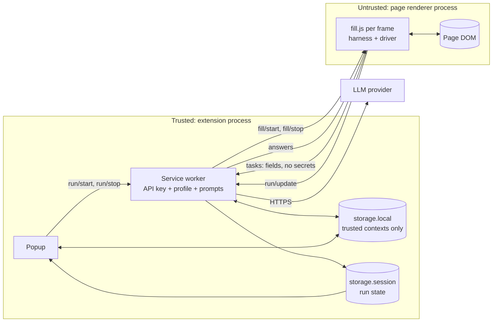

# Architecture

## Layout

```
public/               Static files copied into dist/: manifest, popup HTML and CSS, icons, locales
src/
  shared/             Types and pure helpers used everywhere
    types.ts          FieldView, RunReport and friends
    protocol.ts       Every message between popup, worker and frames
    settings.ts       Storage rules and the v2 migration
    providers.ts      Provider registry
    i18n.ts           EN and 中文 strings
    errors.ts         LlmError, RunStopped, BudgetExhausted
  harness/            The run loop; see HARNESS.md. Touches no browser API.
    runner.ts         Snapshot, plan, apply, verify, audit, report
    widget.ts         Deterministic pick, then a bounded model loop
    answers.ts        Validates plans
    policy.ts         What is never touched or clicked
    budget.ts         Limits and cancellation
    match.ts          Text, date and option comparison
    json.ts           Tolerant parsing of model replies
    types.ts          The PageDriver and LlmClient ports
  llm/                Trusted side only
    gateway.ts        Streaming, retries, parameter learning
    tasks.ts          Prompts and response validation
  dom/                Implements PageDriver
    scan.ts           DOM to FieldViews
    actuate.ts        Writing to controls so frameworks notice
    driver.ts         Ties it together; enforces policy
    text.ts           Visibility and visible text
  background/index.ts Service worker
  content/
    fill.ts           A fill run in one frame (injected on demand)
    quick-query.ts    The Quick Query trigger (registered only while enabled)
    llm-client.ts     Content side of the model port
    panel.ts          On-page status panel
  popup/index.ts      Popup UI
tests/                See TESTING.md
evals/                Live scoring against a real model
```

The dependency rule: `harness/` knows nothing about Chrome or the DOM, only its two ports. That is why the same loop runs against an in-memory page in unit tests, real DOM in Chromium, and a scripted or live model.

## Processes and trust



**The boundary that matters:** content scripts share a process with whatever page they run in, so they hold no secrets.

- The API key and the profile exist only in the service worker and the popup.
- `storage.local` access is set to `TRUSTED_CONTEXTS`, so a content script cannot read it. A test asserts this.
- A content script sends a task ("plan these fields") and gets back the answers, which that page was about to receive anyway.
- Prompts live in `llm/tasks.ts`, which only the worker bundles.

## Why the run lives in the content script

It would be natural to run the harness in the service worker. It would also be wrong: Chrome can stop a worker at any moment, while a content script lasts exactly as long as the page being filled. So:

| State | Lives in | Survives a worker restart because |
|---|---|---|
| The run itself | Content script | Unaffected by the worker |
| A model call in flight | Worker | The dropped port is noticed and the call is sent again |
| Progress and report | `storage.session`, one key per frame | Outside the worker; the popup reads it directly |

The worker keeps nothing in memory. A test stops it mid-call and asserts the run still finishes.

## A fill run

1. **Start.** The popup sends `run/start`. The worker checks the profile and key, then injects `fill.js` into every frame of the tab. Nothing is injected before this.
2. **Each frame runs independently.** The worker writes a `running` state per frame and sends `fill/start`. A frame with no fields ends at once, at no model cost, so ad iframes are free.
3. **Model calls.** Each opens its own `llm` port to the worker, which adds the profile and key, calls the provider, and replies. Disconnecting the port cancels the fetch; that is how Stop works.
4. **Progress.** Frames post `run/update`; the worker writes `storage.session`; the popup redraws from `storage.onChanged`. Closing and reopening the popup mid-run loses nothing.
5. **End.** The on-page panel lists anything needing attention, and clicking an item scrolls to it. The popup shows the same report.

Frames are independent by design. Cross-origin frames cannot share a DOM anyway, and independence means no coordinator state in the worker to lose.

## Quick Query

A small content script, registered with `chrome.scripting.registerContentScripts` only while the feature is on. When off, it injects nothing anywhere. It watches `input` events for a trailing ` ``` ` or `···`, refuses fields that policy blocks, and asks the worker to continue the text. If the user kept typing while the model was thinking, their text wins and the result is discarded.

## Storage

| Data | Area | Notes |
|---|---|---|
| Settings, API keys, profile | `storage.local` | Trusted contexts only |
| Profile text and timestamp | `storage.sync` | Newest write wins across devices. Skipped if over the 8 KB item limit, and the popup says so. |
| Run state and reports | `storage.session` | Memory only. Cleared on navigation and tab close. |

API keys are never written to `storage.sync`. v2 did this; the migration removes them.

### Migration

`loadSettings` detects v2 keys, converts them, and deletes them from both areas. It keeps the newer profile by timestamp. See `migrateLegacy` in [`settings.ts`](../src/shared/settings.ts). This runs for store updates, which keep the extension id; an unpacked install has a new id once it loads from `dist/`, and so starts empty.

## Build

[`scripts/build.mjs`](../scripts/build.mjs) uses esbuild to bundle four entry points into `dist/` as IIFEs and copies `public/`. No runtime dependencies. TypeScript is erasable-syntax-only, so Node runs tests directly from source.

To publish, zip the contents of `dist/` (not the folder itself) and upload that to the Chrome Web Store.

## Permissions

| Permission | Why |
|---|---|
| `storage` | Settings and run state |
| `scripting` | On-demand injection; Quick Query registration |
| `<all_urls>` | Filling forms on any site, including cross-origin frames, and calling providers from the worker |

v2 declared content scripts on every page; v3 injects nothing until asked.
